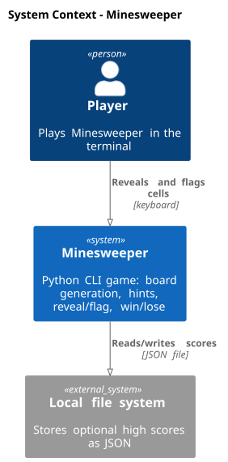

# 03 — Context and Scope

This chapter fixes the system boundary: what "Minesweeper" is responsible for, which external
parties it interacts with, and what is explicitly out of scope.

## 3.1 System Context Diagram

The diagram shows the Minesweeper system as a single black box with two external parties: the
human **Player** and the **Local file system**. There is no network boundary, no server, and no
third party.

## 3.2 External Actors

| Actor | Kind | Interest / Interface |
|-------|------|----------------------|
| Player | Human (primary) | Interacts through the keyboard (`sys.stdin`): chooses board size/mine count, reveals and flags cells, restarts, quits. Receives the rendered grid and prompts via `sys.stdout`. |
| Local file system | External system | Holds optional best-time scores as a single JSON file. The game reads it on start (if present) and writes to it after a win that improves a record. |

No other actors exist. There is no multiplayer peer, no online leaderboard service, no system
administrator, and no automated feeder.

## 3.3 External Interfaces

| # | Interface | Direction | Technology | Notes |
|---|-----------|-----------|------------|------|
| I1 | Commands (reveal, flag, restart, quit, new-game config) | Player → System | Text lines on `sys.stdin` | Parsed by the Presentation adapter; never reaches the domain directly. |
| I2 | Grid rendering, prompts, messages | System → Player | Text on `sys.stdout` | Plain text only; no colors, no cursor control (constraint T7). |
| I3 | Best-time records | System ↔ File system | Read/write a JSON file via `pathlib` + `json` | Optional (F8). Malformed or missing file must not crash the game; it degrades to "no records". |

## 3.4 System Scope

### In scope

- Generating a board with configurable rows, columns, and mine count from a seedable RNG.
- Computing the hint field (8-neighbour mine counts) — the base kata.
- The interactive game loop: reveal, flag/unflag, flood-fill on revealing a 0, win/lose detection.
- Optional local persistence of best clear times per difficulty.
- A single-player, single-process, terminal experience.

### Out of scope

| Excluded item | Reason |
|---------------|--------|
| Graphical or web UI | Terminal-only by goal; constraint T7. |
| Multiplayer or online play | Single-user, offline by goal NF3. |
| A real database | JSON file is sufficient; constraint T4. |
| Timer precision beyond wall-clock seconds | Best-time tracking is optional and casual. |
| Mouse, colors, or cursor control | Portability; constraint T7. |
| A hint/solver, auto-play, or AI opponent | Not part of the kata; YAGNI. |
| Cloud sync, accounts, authentication | No network; constraint T4. |
| Custom board shapes or non-rectangular fields | The kata is rectangular N×M. |

## 3.5 Responsibilities Assigned to the System

In C4 terminology, at this level the system is one container-less box. Its responsibilities,
which the Container and Component views (Chapter 5) decompose, are:

1. **Generate** — produce a deterministic board layout from an injected seed.
2. **Compute hints** — the pure kata transformation.
3. **Play** — manage game state and enforce reveal/flag/flood-fill/win/lose rules.
4. **Present** — render state and read commands in the terminal.
5. **Persist (optional)** — read/write best times to a local JSON file.

These five responsibilities map directly onto the bounded contexts (Board, Game, Presentation)
plus an optional storage adapter, all elaborated in Chapter 5.
