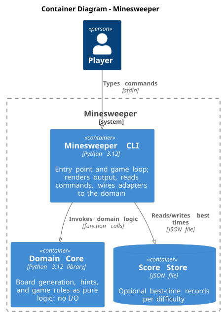
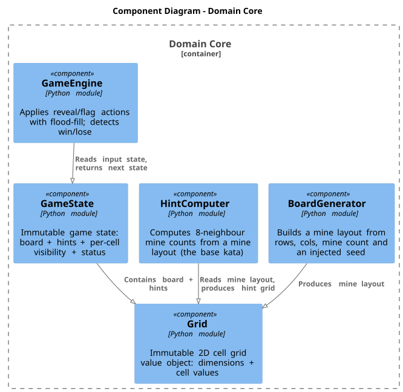
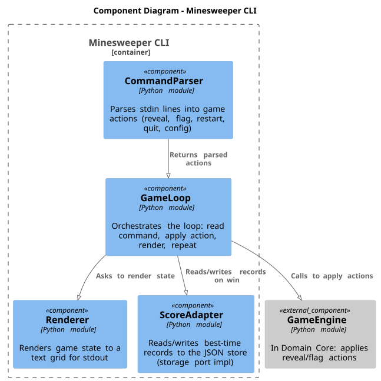

# 05 — Building Block View

This chapter decomposes the system from the C4 System Context (Chapter 3) into its **containers**
and then into the **components** inside each container. It follows the hexagonal structure and
the three bounded contexts (Board, Game, Presentation) established in Chapter 4.

## 5.1 Level Structure

| Level | View | Diagram |
|-------|------|---------|
| 1 | System Context (black box) | [Chapter 3](03-context-and-scope.md) |
| 2 | Containers | §5.2 — `diagrams/c4-container.svg` |
| 3 | Components of the Domain Core | §5.3 — `diagrams/c4-component-core.svg` |
| 3 | Components of the Minesweeper CLI | §5.4 — `diagrams/c4-component-cli.svg` |

## 5.2 Container Level



### Containers

| Container | Technology | Responsibility |
|-----------|------------|----------------|
| **Minesweeper CLI** | Python 3.12 (`python -m minesweeper`) | The only executable container. Runs the game loop, renders the board to stdout, reads commands from stdin, and wires the storage adapter to the domain. |
| **Domain Core** | Python 3.12 library (stdlib only) | Board generation, hint computation, and the game rules as pure logic. Performs no I/O and holds no hidden randomness. Not independently runnable. |
| **Score Store** | JSON file | Optional best-time records per difficulty. A `ContainerDb` because it is passive data, not code. |

### Relationships

- Player → **Minesweeper CLI**: types commands on `stdin`.
- **Minesweeper CLI** → **Domain Core**: invokes board generation and game actions as plain
  function calls.
- **Minesweeper CLI** → **Score Store**: reads and writes best-time records as JSON.

**Purity rule:** there is deliberately **no** relationship from Domain Core to Score Store. The
core never touches storage; the CLI mediates (constraint C7). This is the single most important
property of the container view and the reason the domain is unit-testable in isolation.

## 5.3 Component Level — Domain Core



The Domain Core container holds two bounded contexts. Components are grouped by context; the
**Grid** value object is shared across the boundary, which is intentional (value objects at the
seams, per §4.4).

### Board context

| Component | Module | Responsibility |
|----------|--------|----------------|
| **Grid** | `board/grid.py` | Immutable 2D value object: dimensions plus per-cell values. The shared data model for layout and hints. |
| **BoardGenerator** | `board/generator.py` | Given rows, columns, mine count, and an **injected** `random.Random`, returns a mine-layout `Grid`. Pure (no module-level `random.*`, constraint T6). |
| **HintComputer** | `board/hints.py` | Given a mine layout, returns a hint `Grid` with 8-neighbour mine counts — the base kata. Pure and stateless. |

### Game context

| Component | Module | Responsibility |
|----------|--------|----------------|
| **GameState** | `game/state.py` | Immutable game state: the board, the hint counts, per-cell visibility (hidden/revealed/flagged), and status (`playing` / `won` / `lost`). |
| **GameEngine** | `game/engine.py` | Applies an action (reveal or flag) to a `GameState` and returns the next `GameState`. Owns flood-fill and win/lose detection. Pure function of `(state, action) → state`. |

### Relationships within the core

- `BoardGenerator` → `Grid`: produces the mine layout.
- `HintComputer` → `Grid`: reads the mine layout, produces the hint grid.
- `GameState` → `Grid`: contains the board and hints.
- `GameEngine` → `GameState`: reads the input state, returns the next state.

The **initial** `GameState` is assembled by the caller (the CLI's `GameLoop`, §5.4) by calling
`BoardGenerator` then `HintComputer` then constructing the state. This keeps the domain
components minimal and puts setup orchestration in the Presentation layer, where the I/O-driven
flow belongs.

## 5.4 Component Level — Minesweeper CLI



The CLI container holds the Presentation context plus the storage adapter. `GameEngine` is
shown as an **external** component to make the key cross-container dependency explicit: the
loop drives the domain, never the reverse.

### Presentation context

| Component | Module | Responsibility |
|----------|--------|----------------|
| **CommandParser** | `presentation/parser.py` | Parses stdin lines into game actions (reveal, flag, restart, quit, new-game config). Rejects malformed input. |
| **Renderer** | `presentation/renderer.py` | Renders a `GameState` to a plain-text grid for stdout. No colors, no cursor control (T7). |
| **GameLoop** | `presentation/loop.py` | Orchestrates the session: render → read command → parse → apply action via `GameEngine` → repeat until win, lose, or quit. Owns the wall-clock timer for best-time tracking. |

### Storage adapter

| Component | Module | Responsibility |
|----------|--------|----------------|
| **ScoreAdapter** | `presentation/score_adapter.py` | Implements the storage port: reads/writes best-time records to the Score Store JSON file. Degrades gracefully if the file is missing or malformed (interface I3). |

### Relationships

- `CommandParser` → `GameLoop`: returns parsed actions.
- `GameLoop` → `Renderer`: asks to render state.
- `GameLoop` → `ScoreAdapter`: reads records at start, writes a record on a win that improves the
  best time.
- `GameLoop` → `GameEngine` (external, in Domain Core): calls to apply reveal/flag actions and
  advance state.

## 5.5 Module / Package Layout

The folder layout enforces the dependency rule structurally (constraint C7): `board` and `game`
import nothing from `presentation`, and `presentation` imports from `board` and `game` but not
from any test. Tests mirror the source tree (convention C6).

```
minesweeper/
├── __init__.py
├── __main__.py            # entry point: `python -m minesweeper`
├── board/                 # Board context (pure)
│   ├── __init__.py
│   ├── grid.py            # Grid
│   ├── generator.py       # BoardGenerator
│   └── hints.py           # HintComputer (the kata)
├── game/                  # Game context (pure)
│   ├── __init__.py
│   ├── state.py           # GameState
│   └── engine.py          # GameEngine (reveal/flag/flood-fill/win-lose)
└── presentation/         # Presentation context (adapter) + storage
    ├── __init__.py
    ├── parser.py          # CommandParser
    ├── renderer.py        # Renderer
    ├── loop.py            # GameLoop
    └── score_adapter.py   # ScoreAdapter
tests/
├── board/                 # mirrors board/
├── game/                  # mirrors game/
└── presentation/          # mirrors presentation/
```

This layout is illustrative; exact file names may be refined by the implementation, but the
three-context split and the dependency direction are fixed.

## 5.6 Building Block Summary

| # | Block | Level | Context | Pure? |
|---|-------|-------|---------|-------|
| 1 | Minesweeper CLI | Container | Presentation | No (I/O) |
| 2 | Domain Core | Container | Board + Game | Yes |
| 3 | Score Store | Container (data) | — | — |
| 4 | Grid | Component | Board | Yes |
| 5 | BoardGenerator | Component | Board | Yes |
| 6 | HintComputer | Component | Board | Yes |
| 7 | GameState | Component | Game | Yes |
| 8 | GameEngine | Component | Game | Yes |
| 9 | CommandParser | Component | Presentation | No (stdin) |
| 10 | Renderer | Component | Presentation | No (stdout) |
| 11 | GameLoop | Component | Presentation | No (orchestration + timer) |
| 12 | ScoreAdapter | Component | Presentation | No (file I/O) |

The runtime interactions between these blocks, for the key scenarios, are shown as sequence
diagrams in [Chapter 6](06-runtime-view.md).
