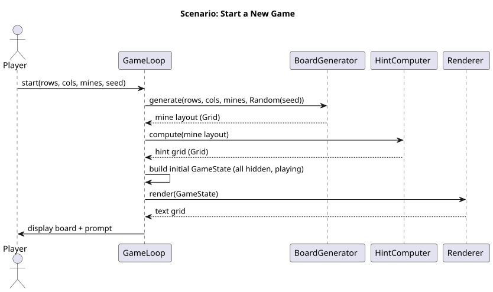
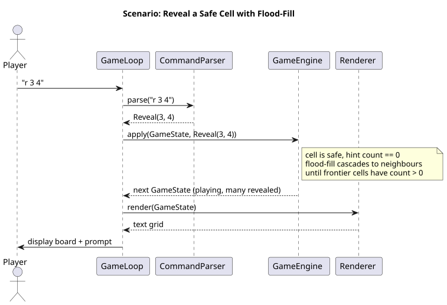
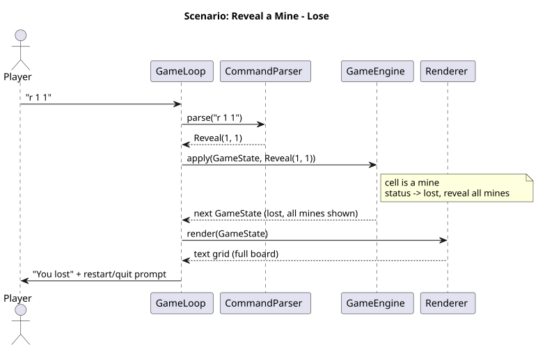
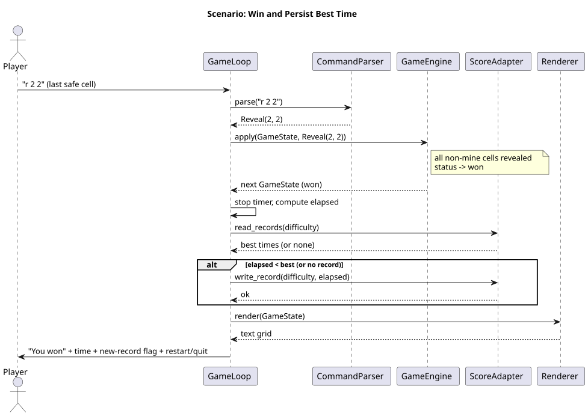

# 06 — Runtime View

This chapter shows how the building blocks from Chapter 5 cooperate at runtime, for the
scenarios that most strongly exercise the architecture. Each scenario is a PlantUML sequence
diagram. The recurring property across all of them: **all domain work stays in the pure core,
and the CLI is the only participant that touches `stdin`, `stdout`, or the file system**.

## 6.1 Scenarios

| # | Scenario | What it exercises |
|---|----------|-------------------|
| 1 | Start a new game | Board generation from a seed → hint computation → initial state assembly. |
| 2 | Reveal a safe cell with flood-fill | The core gameplay: reveal cascading into neighbours, the most complex domain transition. |
| 3 | Reveal a mine — lose | Terminal state transition and full-board reveal. |
| 4 | Win and persist best time | Win detection plus the optional storage adapter path. |

The simpler actions — flag/unflag, restart, quit — are straightforward subsets of the flows
below (parse → `GameEngine.apply` → render) and are described in text only at the end.

## 6.2 Scenario 1 — Start a New Game

The player supplies dimensions, mine count, and a seed. `GameLoop` drives setup in the correct
order:

1. `BoardGenerator.generate(rows, cols, mines, Random(seed))` → mine-layout `Grid`. The seed is
   injected here, so the same seed always yields the same board (constraint T6).
2. `HintComputer.compute(mine layout)` → hint `Grid`. This is the base kata, pure.
3. `GameLoop` assembles the initial `GameState` (all cells hidden, status `playing`) from the two
   grids. Assembly lives in Presentation, not in a domain factory, keeping the domain components
   single-purpose.
4. `Renderer` turns the state into a text grid; the loop displays it and prompts for input.

No domain participant does I/O. The board is reproducible from the seed, which is what lets a
later BDD scenario replay a known board.

## 6.3 Scenario 2 — Reveal a Safe Cell with Flood-Fill

This is the core gameplay loop and the most intricate domain logic:

1. The player types a reveal command; `CommandParser` turns the text into a `Reveal(row, col)`
   action. Parsing is Presentation-only.
2. `GameLoop` calls `GameEngine.apply(state, action)`. The engine is a pure function: it reads the
   state and the action, and returns the next state.
3. Inside the engine: the cell is safe and its hint count is `0`, so flood-fill recurses into the
   8-neighbours, revealing each `0` cell and stopping at cells with a non-zero count (goal F4).
4. The engine returns the next `GameState` with many cells revealed and status still `playing`.
5. `GameLoop` renders and displays; the loop repeats.

Because `GameEngine` is a pure `(state, action) → state` function, a flood-fill can be unit-tested
by asserting on the returned state alone — no terminal, no timer, no file.

## 6.4 Scenario 3 — Reveal a Mine — Lose

1. Parse a reveal command as before.
2. `GameEngine.apply` finds the revealed cell is a mine: it sets status to `lost` and reveals
   every mine (goal F7).
3. The returned state has status `lost` and the full mine layout visible.
4. `Renderer` shows the complete board; `GameLoop` prints a loss message and a restart/quit
   prompt. No score is written.

## 6.5 Scenario 4 — Win and Persist Best Time

1. The player reveals the final safe cell. `GameEngine.apply` detects that every non-mine cell is
   revealed and sets status to `won` (goal F6).
2. `GameLoop` stops the wall-clock timer and computes elapsed time.
3. It asks `ScoreAdapter.read_records(difficulty)` for the current best times. The adapter returns
   either stored records or none if the file is missing/malformed (interface I3 graceful
   degradation).
4. If the elapsed time beats the stored best (or no record exists), `GameLoop` calls
   `ScoreAdapter.write_record(difficulty, elapsed)`.
5. The loop renders the winning board and shows the time, a new-record flag, and a restart/quit
   prompt.

This is the only scenario that touches the Score Store, and it does so entirely through the
`ScoreAdapter` — the domain never knows scores exist. Removing the adapter disables F8 without
affecting any rule.

## 6.6 Other Runtime Flows (text only)

- **Flag / unflag:** Player types a flag command → `CommandParser` → `Flag(row, col)` action →
  `GameEngine.apply` toggles the flag and returns the next state → render. Flags never reveal and
  never affect win/lose (goals F5, F6).
- **Restart:** Player types restart → `GameLoop` discards the current state and re-runs the
  Scenario 1 setup (optionally with the same seed for a replayable board).
- **Quit:** Player types quit → `GameLoop` exits the loop and the process ends with exit code 0
  (environment E6). No state is persisted on quit.

## 6.7 Concurrency and Ordering

The system is single-threaded (constraint T8). Every scenario is a strict request/response cycle:
exactly one command in, one state transition, one render out. There are no background tasks, no
timers interrupting the loop (the timer is read only at win), and no shared mutable state across
requests — `GameState` is immutable, so each action produces a fresh value. This is what makes
the runtime sequences linear and easy to reason about.
