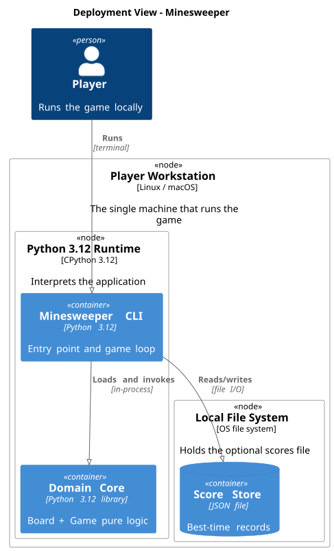

# 07 — Deployment View

This chapter describes how the software is installed and run. Because the system is a local,
single-process, single-user game (constraint T4, T8), the deployment is deliberately trivial:
one workstation, one Python process, one optional data file. There is nothing to provision, no
server to start, and no network to configure.

## 7.1 Deployment Diagram



The diagram nests the Chapter 5 containers inside the physical environment they run in.

## 7.2 Deployment Nodes

| Node | Technology | Contents | Notes |
|------|------------|----------|-------|
| Player Workstation | Linux or macOS (POSIX) | Everything | The only host; no remote machines (T4). |
| └ Python 3.12 Runtime | CPython 3.12 | `Minesweeper CLI` container + `Domain Core` library container | Both load into a single process; the core is not a separate process. |
| └ Local File System | OS file system | `Score Store` JSON file | Optional (F8). A plain file in the user's data/config directory. |

The player is shown outside the workstation to keep the human separate from the deployed
software, consistent with the context view (Chapter 3).

## 7.3 How the Software Is Run

There is no build step. The game is launched directly from source with the standard library:

```bash
python -m minesweeper
```

- The `__main__.py` entry point creates the adapters, constructs the first game, and starts the
  `GameLoop` (Chapter 6, Scenario 1).
- A single process holds the CLI and the Domain Core in memory together; the core is loaded, not
  deployed separately.
- Standard library only at runtime (T2); the only external package, `pytest`, is not present at
  run time (T3).

## 7.4 Configuration

| Aspect | Default | How it is supplied |
|--------|---------|--------------------|
| Board size / mine count | Prompted at start, or CLI arguments | Interactive input on `stdin`; exact source decided in implementation. |
| RNG seed | Player-chosen or derived (e.g. time) | Injected into `BoardGenerator` (T6). A fixed seed makes a board replayable. |
| Score file path | User data/config directory, e.g. `~/.local/share/minesweeper/scores.json` (POSIX) | A conventional path; overridable if needed. |
| Persistence on/off | On when the file is writable | If the file is missing or malformed, the game runs without scores (I3). No flag is strictly required. |

There is no environment-variable-driven cloud config, no secrets, and no service endpoints —
none apply to a local single-user game.

## 7.5 Mapping to Building Blocks

| Chapter 5 container | Deployment location |
|---------------------|----------------------|
| Minesweeper CLI | Python 3.12 Runtime, one process |
| Domain Core | Python 3.12 Runtime, same process (loaded as a library) |
| Score Store | Local File System, one JSON file |

The deployment does not split the Domain Core from the CLI: doing so would add IPC for no
benefit in a single-user, turn-based game. Keeping them in one process is a direct consequence of
the simplicity goal (Chapter 1, quality goal 3) and the no-server constraint (T4).

## 7.6 Failure and Recovery

- **Process crash:** the game exits with a non-zero code (E6). No persisted game state exists, so
  there is nothing to recover — the player starts a new game. This is acceptable for a casual
  terminal game; no save/resume feature is in scope (§3.4).
- **Malformed or missing score file:** `ScoreAdapter` catches the error and degrades to "no
  records" rather than crashing (I3). The game continues; a later win writes a fresh valid file.
- **Unreadable score directory:** same graceful degradation — persistence is silently disabled for
  that session.

## 7.7 Operational Summary

| Item | Value |
|------|-------|
| Processes | 1 |
| Threads | 1 (T8) |
| Network ports | 0 |
| External services | 0 |
| Files written | 1 (optional scores JSON) |
| Start command | `python -m minesweeper` |
| Stop | player types `quit`, or `Ctrl-C` / terminal close |
